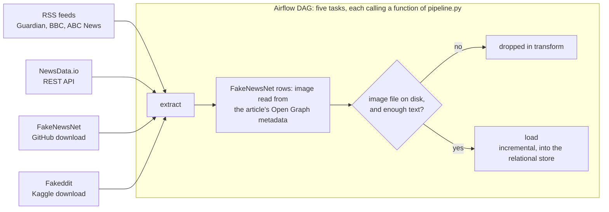
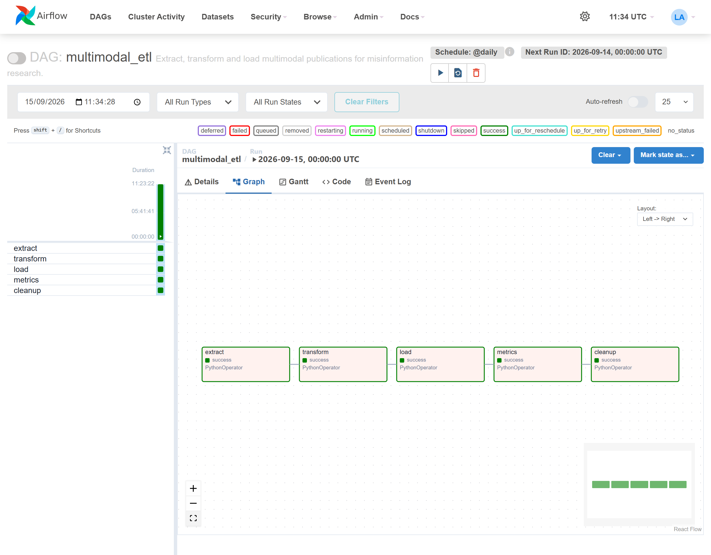

<h1 align="center">Multimodal ETL</h1>

<p align="center">An Airflow pipeline that collects news text with its image from four sources into a database</p>

<p align="center">
  
  
  
  
</p>

<div align="justify">

**Project status** — no longer developed. One command runs the whole chain against the live
sources and the versioned Fakeddit sample, so a new run collects a different corpus from the one
measured on this page.
`reports/run-evidence.json` records the last check, made on 2026-10-10: `scripts/smoke.py` ran
the pipeline on the versioned Fakeddit sample and regenerated two published files, which came
out identical to the committed ones. The CI workflow, launched manually, checks the code with
Ruff, Bandit and pytest, and none of its tests reads the four live sources.

## The problem

A dataset for multimodal fake-news detection needs a text and an image for every row. The
sources used here deliver the text reliably and the image less so. An image URL in an RSS feed
may return an error, the FakeNewsNet CSVs contain no image at all, and the NewsData.io API stops
answering once its quota is spent.

A dataset that kept such rows with only an image URL would look complete, and it would lose a
row for every dead link as soon as a model was trained on it.

This pipeline keeps a publication only when its image file is on disk. Each image URL is
downloaded, and the file is opened with Pillow, before the row can be kept. Running the
extraction again repeats every image download, and spends one NewsData.io call when a key is
set. The transform step is therefore designed to run again on its own, from the last
extraction, without downloading anything.

## What it does

The pipeline reads four sources, each through a different access method:

| Source | Access | What it brings |
|---|---|---|
| RSS feeds (The Guardian, BBC, ABC News) | `rss_feed` | volume and freshness |
| NewsData.io API | `rest_api` | structured news |
| FakeNewsNet | `github_download` | academic ground truth |
| Fakeddit | `kaggle_download` | annotated multimodal volume |

The FakeNewsNet CSVs carry no image, so the pipeline looks for one in the Open Graph metadata of
up to 40 article pages per run. A publication that still has no usable image is dropped at the
transform step. [`docs/data-source.md`](docs/data-source.md) explains the choice of these four
sources and the decision to leave HTML scraping out.

An Airflow DAG chains five tasks. Each task calls one function of `pipeline.py`, the module the
command-line scripts call as well.



<!-- source: docs/images/MANIFEST.json -->


A Streamlit dashboard reads the latest dataset and the run records, and shows each indicator
next to the bound that [`docs/protocol.md`](docs/protocol.md) gives for it.
[`docs/interface.md`](docs/interface.md) describes each section of the page.

<!-- source: docs/images/MANIFEST.json -->


### How it is built

**Airflow** runs five `PythonOperator` tasks, and each one calls a function of `pipeline.py`.
The command-line scripts call the same five functions, and the notebooks call the lower-level
functions of the same package. [`docs/architecture.md`](docs/architecture.md) explains what this
arrangement allows. **Docker** builds the image Airflow runs in, with the pipeline's
dependencies installed under Airflow's constraints file.

**feedparser** parses the RSS feeds, and requests makes every HTTP call. **Beautiful Soup**
reads the Open Graph metadata of the FakeNewsNet articles with the lxml parser, and **Pillow**
opens every downloaded image before its row can be kept. **pandas** builds the dataset, parses
the dates and removes duplicates, and **PyArrow** writes it as **Parquet**. **SQLAlchemy** loads
it into SQLite by default, and `MULTIMODAL_ETL_DB_URL` can point the loader at **PostgreSQL**,
which the compose file also runs as Airflow's metadata database. Its driver, psycopg2, comes with
the Airflow image and is not a dependency of the project itself. The data goes into six tables,
described field by field in [`docs/DB.md`](docs/DB.md), and their primary keys make a replay
idempotent.

The dashboard is built with **Streamlit** and **Plotly**, in the colours of the palette module
that the notebook figures use. uv keeps the environment locked to its lock file. **Ruff** and
**Bandit** check the code in the CI workflow and in the pre-commit hooks. The **pytest** suite
has three tiers. In the outermost one, a test runs the pipeline in a subprocess against an RSS
feed that the test serves itself, and another starts the dashboard with the command given below
and requests its page.

## The result

The figures below come from the second of two runs of the Airflow DAG on 2026-09-15, made back
to back. NewsData.io had no key and turned itself off. The Fakeddit connector found no Kaggle
export and read the synthetic sample described under "Licence and data". The RSS feeds and the
FakeNewsNet article pages were read live. [`docs/runbook.md`](docs/runbook.md) carries
excerpts of the output of both runs.

<!-- source: reports/data_quality.json -->
Of the n = 171 publications collected, **127 were kept**. **100 % of 127 pair a text with an
image file** on disk, and **22 % of 127 carry a ground-truth label**. Of the 28 labelled rows,
20 come from the synthetic Fakeddit sample and 8 from the GossipCop files of FakeNewsNet.

<!-- source: reports/indicators.json -->
All nine indicators of [`docs/protocol.md`](docs/protocol.md) were within their bounds for that
run, which collected n = 171 publications. The validity rate was **74.3 %**, 127 of 171, against
a bound of 60 %. Of 136 attempted image downloads, **94.9 %** succeeded, against a bound of
80 %. Extract, transform and load took **66.41 s** together, against a bound of 90 s, and the
count of failed sources was **0**.

**The load cannot duplicate a row.** Every table has a primary key and every insert skips a key
already present, so the database enforces idempotency whichever writer arrives first.
`docs/architecture.md` explains why the loader was rewritten around that constraint.

<!-- source: docs/runbook.md -->
Both runs collected n = 171 publications. The first kept 118 and wrote all 118 to an empty
database. The second kept 127, because nine images that had failed to download in the first run
succeeded in the second, and it wrote **9** new rows. The other 118 were already in the
database, and the `source` table did not change. Of the 44 publications the second run dropped,
42 had no image file, and the other 2 had one but failed the title or text-length check.

A test writes a duplicate key straight to the database with its own `INSERT`, bypassing the
loader, and checks that the database raises `IntegrityError`.

**The transform and load tasks can be replayed on their own.** `docs/runbook.md` shows the
transform task replayed after the working area had been emptied. It read the last archived
extraction and succeeded without running the extraction again.

**A failing source does not stop the others.** The fourteen tests of
`tests/integration/test_partial_failure.py` simulate a spent quota, a timeout, a malformed
answer, a truncated image, an oversized image and a network error on one image of the download
loop. Five of them run the real RSS, NewsData.io and FakeNewsNet connectors, with only the
network answer simulated, and one of those checks that the NewsData.io key stays out of the log.
When a connector raises an exception, the extract step records its cause as `quota`, `network`
or `malformed` and counts it as an incident. The RSS, NewsData.io and FakeNewsNet connectors
raise when their feeds, their API call or their CSV downloads fail, and an HTTP 429 answer is
recorded as `quota`. A connector that returns nothing without an error is recorded as `empty`, or
as `disabled` for NewsData.io without a key, and the dashboard shows those two outcomes outside
the failed-sources count. The RSS and FakeNewsNet connectors each read several feeds or files,
and they raise only when none of them delivered a publication.

The screenshot below was taken before the connectors raised their request failures. Its RSS
connector was aimed at a local port with no server behind it, and the table shows that source as
one that answered with nothing. With the current code, the same configuration reports that
connector as unreachable and counts one failed source.

<!-- source: docs/images/MANIFEST.json -->


<!-- source: reports/data_quality.json -->
**On this corpus, the deduplication key misses no pair that the two measures can detect.** Both
measures run over the n = 127 publications kept. The first looks for one article reached through
two URL variants, and the second for one headline published under two different URLs. Both find
**0** pairs. A test injects a realistic republication, with tracking parameters, a `www.` prefix
and the headline in capitals, and checks that both measures find it, so the zero describes the
corpus.

The key remains fragile. It hashes the URL as collected and the cleaned title, so a corrected
typo or an added tracking parameter gives the same article a new identifier. It was left
unchanged because the measures found nothing to fix, and rehashing would change every
publication's identifier for a before-and-after of 0 to 0. This corpus also gives the key little
to catch, since no two of its publications share a headline. A wire story republished by two
outlets carries two different URLs, which URL normalisation cannot bring together, so only the
title measure can detect it.

### What the kept rows are worth for training

`reports/data_quality.md` is rendered by `scripts/quality_report.py` from
`reports/data_quality.json`. Its most useful comparison sets the labelled rows against the
unlabelled ones:

<!-- source: reports/data_quality.json -->
> Of the n = 127 publications kept, the 28 labelled ones average **56.1 characters** of text,
> against 383.5 for the 99 unlabelled.

Both labelled datasets provide a headline and no article body, and their connectors use the
headline as the text. The rows a classifier could be fitted on are therefore the rows with the
least text, and a model trained on them would learn from headlines. Twenty of the 28 come from
the synthetic sample, whose titles are also headlines, of 38 to 68 characters. The row count
alone hides this difference, so `reports/data_quality.json` records both means and the report
prints them side by side.

## Why these numbers can be believed

The defects below were found and fixed. The first one prompted the search for the others.

**The load step could not run.** `pipeline.py` imported `run_load` from `load.py` and then
defined a function of its own under the same name. That definition replaced the imported name at
module level, so the inner call reached the pipeline's own function, which accepts at most one
argument and was given two:

```
TypeError: run_load() takes from 0 to 1 positional arguments but 2 were given
```

That broken state appears in no commit. The commit that repaired it, `4ead56a`, renamed the
loader's function to `load_dataset` and added a regression test that describes the failure. As a
result of the bug, the third task of the Airflow DAG could not complete. No test covered that path,
because each existing test exercised a single module and the step that chains them had no test
of its own. The database looked healthy because it had been filled before the shadowing was
introduced.

**Inside the container, the project root depended on where the process started.** The package
finds its root by looking for `pyproject.toml` above its own directory. In a mount that lacked
that file, the search fell back to the working directory, `/opt/airflow`. All five tasks
succeeded while the run wrote its files outside the project. The compose file now sets the root
explicitly, through `MULTIMODAL_ETL_ROOT`.

**A copy of the whole repository was committed inside itself.** The 72-file archive was purged
from the full history, after which the repository weighed 491 KiB.

**The code was in French and the documentation in English.** 34 of the 35 Python files had
French docstrings, and the run records, the statistics files and three SQL tables used French
keys. All of these are now in English. Translating the DAG renamed its tasks, and the runbook
then still told the reader to run `airflow tasks test multimodal_etl transformation`, for a task
that had become `transform`.

**The published report could not be reproduced.** It was recomputed from whatever dataset was on
disk, so two readers on two machines got two different files from the same command. Measuring
and publishing are now separate steps. `--measure` writes the measures of the latest dataset on
disk, with the date they were taken, to `reports/data_quality.json` and
`reports/indicators.json`. The default run renders the markdown from `reports/data_quality.json`
alone.

Tests check two further properties. The bounds are defined once, in
`multimodal_etl.kpi.THRESHOLDS`, which the dashboard reads. The table of bounds in
`docs/protocol.md` is written by hand, and a test checks that the document names every indicator
of `THRESHOLDS`. The schema follows the same pattern: `schema.py` describes every field,
`scripts/build_schema_diagram.py` generates `docs/data_schema.mmd` from it, and the dictionary in
`docs/DB.md` is written by hand. A test fails when a field of `schema.py` is missing from the
diagram or from the dictionary.

## Running it

```powershell
uv sync --extra dev
uv run python scripts/run_etl.py            # the whole pipeline, one command
uv run streamlit run src/multimodal_etl/dashboard.py   # the dashboard
uv run python scripts/quality_report.py     # re-render reports/data_quality.md
```

The pipeline needs no key. It reads the RSS feeds, FakeNewsNet and the versioned Fakeddit
sample, and a NewsData.io key turns on the fourth source. Without the key, that source turns
itself off and the run continues. Each step also runs on its own:

```powershell
uv run python scripts/run_extract.py
uv run python scripts/run_transform.py
uv run python scripts/run_load.py
```

When the previous step's working file has been cleared, a step run on its own reads the last
archived artefact. Environment variables steer a run without any change to the code, and
`.env.example` lists them. `MULTIMODAL_ETL_DATA_DIR` moves everything a run writes except the
logs, `MULTIMODAL_ETL_SOURCES` selects the connectors, and `MULTIMODAL_ETL_RSS_FEEDS` points the
feed reader at other feeds.

Airflow, locally (the full walkthrough is in [`docs/runbook.md`](docs/runbook.md)):

```powershell
docker compose -f infra/docker-compose.airflow.yaml build
docker compose -f infra/docker-compose.airflow.yaml up -d
# http://localhost:8080, DAG: multimodal_etl
```

Checks:

```powershell
uv run python -m pytest      # 179 tests in three tiers
uv run ruff check .
uv run bandit -c pyproject.toml -r src
uv run python scripts/smoke.py    # runs the pipeline on the sample and records the run
```

## Structure

```
├── src/multimodal_etl/
│   ├── config.py           paths, and the run parameters as frozen dataclasses
│   ├── schema.py           the publication schema the diagram is generated from
│   ├── sources/            one module per source, and the Open Graph enrichment
│   ├── images.py           download and validation of the images
│   ├── extract.py          step E: collect -> raw JSON + image files
│   ├── transform.py        step T: clean, validate, normalise
│   ├── load.py             step L: incremental relational load
│   ├── transit.py          the working area the steps hand their files through
│   ├── pipeline.py         the five steps, called by the scripts and by the DAG
│   ├── kpi.py              indicators, units and bounds
│   ├── dashboard.py        the Streamlit page
│   └── quality/            measurements on the dataset: duplicates, completeness
├── dags/                   the Airflow DAG, which calls pipeline.py
├── infra/                  image and compose file for a local Airflow
├── docs/
│   ├── architecture.md     the engineering decisions, and the alternatives set aside
│   ├── data-source.md      the four sources, their terms, and the ones ruled out
│   ├── DB.md               the model, the dictionary and the six tables
│   ├── interface.md        what the dashboard shows, and the rules it follows
│   ├── protocol.md         every indicator, its bound, and what crossing it does
│   └── runbook.md          running the orchestration, and the logs of a real run
├── notebooks/              exploration, extraction, transformation, indicators
├── reports/                the data quality measures and the report rendered from them
├── scripts/                the pipeline, the diagram, the report, the captures, the smoke
└── tests/                  unit, integration, system
```

## What this does not prove

**Scale.** A run of 171 publications says nothing about memory use, contention or hash
collisions at a larger volume, and the pipeline's behaviour at scale was not measured. An
artificial volume was considered and set aside, because it would only measure a simulation.

**Concurrency in practice.** The database refuses a duplicate key, which makes concurrent
writers safe in principle. No test runs two loaders at once against the same database.

**That the sources stay reachable.** Every figure here depends on feeds that can change format
or disappear. `docs/protocol.md` names the indicators that would show such a change, and explains
how the bound of the validity rate was set.

**That anything is watched.** The bounds are evaluated only when the dashboard is opened, when
`scripts/quality_report.py --measure` runs, or when `notebooks/04_kpi.ipynb` is executed. A
crossed bound changes the status word in its row of the dashboard, and an `act now` status adds a
banner. No log line is written and no alert is sent, there is no drift detection and no one on
call, and `docs/protocol.md` separates what runs from what a deployment would add.

## Licence and data

The code is published under the MIT licence.

The four sources are read at run time, and each keeps its own terms:

| Source | Access | Terms to observe |
|---|---|---|
| RSS feeds (The Guardian, BBC, ABC News) | public feeds | each publisher's terms of use; headlines and links only |
| NewsData.io | API key | the provider's API terms; no key is shipped |
| FakeNewsNet | download from its repository | its own research licence and citation |
| Fakeddit | download from its host | its own research licence and citation |

The only data file in the repository, `data/samples/fakeddit_sample.tsv`, is **synthetic**. It
holds twenty-four invented rows under nine of the real dataset's column names, illustrated by
freely licensed images hosted on Wikimedia Commons. The tests and the documentation use it to
show the shape of a record without carrying anyone's content. The three dashboard screenshots,
the smoke run and the Fakeddit rows of both runs of 2026-09-15 all come from it. The images a
run downloads go into `data/raw/images/`, which git ignores.

The four notebooks are committed with the outputs of an execution against the live sources.
Those outputs show a few headlines and links read from the sources, and the opening lines of one
Guardian article summary. They contain no image from the sources. Their one figure, in
`notebooks/04_kpi.ipynb`, charts the publications per source and the duration of each step.

`reports/data_quality.json` holds counts, percentages and means, and no headline or URL. The
published report can be regenerated from it byte for byte.

A new run collects a different corpus from the live sources, so the figures on this page carry
the date of the run that produced them.

</div>
