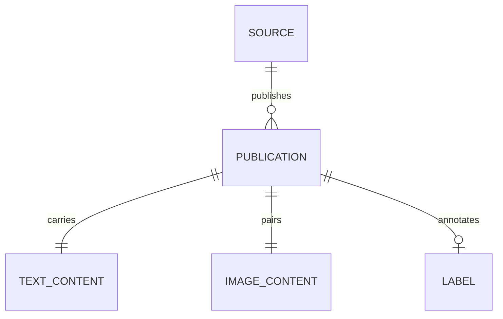
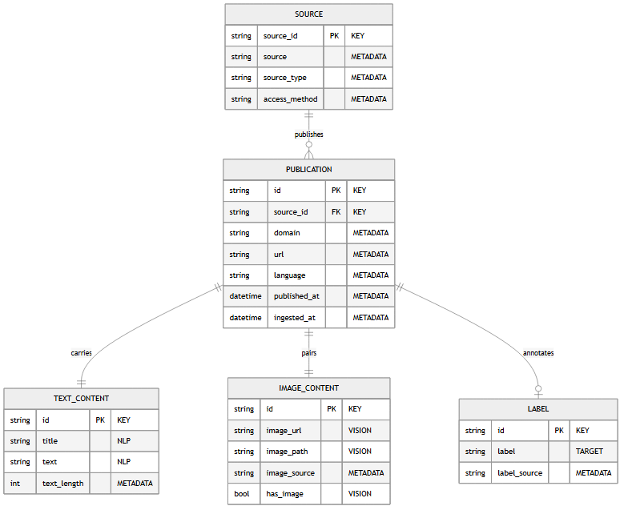

# The data model and the tables

What a publication is, field by field, and the six tables it is written to. The model is
conceptual first: it describes what the data represents, independently of where it is stored.

`src/multimodal_etl/schema.py` describes every field. `scripts/build_schema_diagram.py` generates
the diagram from the schema, and `load.py` builds the tables from it. The field dictionary below
is written by hand, and `tests/integration/test_documentation.py` fails when a field of the schema
is missing from the dictionary or from the diagram.

## The entities

<!-- source: docs/images/MANIFEST.json -->

PUBLICATION is the central entity. It carries a text and pairs an image, and both relations have
cardinality `1—1`. This is how the schema records the rule the dataset is built on: a
publication without an image is not kept. A publication is published by a source, and may be
annotated by a label, with cardinality `0..1`, since only some sources provide one.

`docs/data_schema.mmd` is the Mermaid source of the diagram, written by
`uv run python scripts/build_schema_diagram.py`. When mermaid-cli is available, the same script
renders the picture above and records it in `docs/images/MANIFEST.json`.

## Field dictionary

### PUBLICATION

| Field | Type | Role | Required | Description |
|---|---|---|:---:|---|
| `id` | string | KEY | yes | Unique identifier: hash of the URL and the title. |
| `source_id` | string | KEY | yes | Join key towards SOURCE. |
| `domain` | string | METADATA | yes | Publisher's domain, a reliability signal. |
| `url` | string | METADATA | yes | Original URL: traceability and deduplication. |
| `language` | string | METADATA | yes | Language, ISO 639-1 code. |
| `published_at` | datetime | METADATA | no | Publication date, converted to ISO 8601. |
| `ingested_at` | datetime | METADATA | yes | Ingestion timestamp, for traceability and monitoring. |

### SOURCE

| Field | Type | Role | Required | Description |
|---|---|---|:---:|---|
| `source_id` | string | KEY | yes | Primary key of the source. |
| `source` | string | METADATA | yes | Precise source: `rss:bbc_news`, `newsdata`, `fakenewsnet:politifact`… |
| `source_type` | string | METADATA | yes | Family: `rss`, `api` or `dataset`. |
| `access_method` | string | METADATA | yes | Access method: `rss_feed`, `rest_api`, `github_download`, `kaggle_download`. |

### TEXT_CONTENT

| Field | Type | Role | Required | Description |
|---|---|---|:---:|---|
| `title` | string | NLP | yes | Title, the main textual signal. |
| `text` | string | NLP | yes | Cleaned body or summary, the classification input. |
| `text_length` | integer | METADATA | yes | Length of the cleaned text: a feature and a quality check. |

### IMAGE_CONTENT

| Field | Type | Role | Required | Description |
|---|---|---|:---:|---|
| `image_url` | string | VISION | yes | Original URL of the image. |
| `image_path` | string | VISION | yes | **Path of the downloaded file**, the input of the vision model. |
| `image_source` | string | METADATA | yes | `native` (supplied by the source) or `open_graph` (found on the page). |
| `has_image` | boolean | VISION | yes | True when the file is present on disk. |

### LABEL

| Field | Type | Role | Required | Description |
|---|---|---|:---:|---|
| `label` | string | TARGET | no | Ground truth: `real`, `fake` or `unverified`. |
| `label_source` | string | METADATA | no | Origin of the label, for instance `fakenewsnet:politifact`. |

## What the roles mean for the model downstream

- **NLP** (`title`, `text`): what the language model reads.
- **VISION** (`image_path`, `image_url`, `has_image`): what the vision model sees. `image_path`
  is the field that matters, because it points to a file already on disk, while a URL may stop
  answering.
- **TARGET** (`label`): the variable to predict, when it is available.
- **METADATA**: the reliability and freshness context, usable as secondary features and needed
  by the monitoring.
- **KEY** (`id`, `source_id`): the join keys between entities.

## How the text-image link is checked

Three checks apply, one after another:

1. at extraction, each image is downloaded and then opened with Pillow, and a URL that does not
   return a decodable image leaves no file behind;
2. at transformation, a publication enters the dataset only when its image file is on disk
   (`require_image`);
3. in the indicators, the text-image pairing rate is read against the bound `docs/protocol.md`
   sets for it.

The boolean field `has_image` records the outcome of the second check in every row.

## From the conceptual model to the tables

`src/multimodal_etl/load.py` writes one table per entity, joined by `id` and `source_id`.

| Entity | Table | Primary key | Join key |
|---|---|---|---|
| SOURCE | `source` | `source_id` | — |
| PUBLICATION | `publication` | `id` | `source_id` → `source` |
| TEXT_CONTENT | `text_content` | `id` | `id` → `publication` |
| IMAGE_CONTENT | `image_content` | `id` | `id` → `publication` |
| LABEL | `label` | `id` | `id` → `publication` |

The loader declares the primary keys in the database. The join keys are not declared as
foreign-key constraints. Each load cuts all five tables from the same dataset and writes them one
after another, each in its own transaction, so a load interrupted between two tables can leave
them out of step.

A sixth table, `publications`, keyed on `id`, holds each publication as one flat row. It is meant
for model training, which can then read a complete row without a join. The dashboard reads the
Parquet dataset and the run records, and does not query the database.

## The engine, and what the schema guarantees

The engine is SQLite by default, at `data/db/multimodal_etl.db`. `MULTIMODAL_ETL_DB_URL` gives the
loader another SQLAlchemy URL, and the loader supports SQLite and PostgreSQL, the two dialects
whose insert statement it knows how to make skip a conflict. A PostgreSQL URL needs the psycopg2
driver, which the Airflow image provides and the project's own dependencies do not include, and
no test or recorded run has loaded into PostgreSQL. Every load creates the tables that
do not exist yet, so a fresh clone runs without a migration step.

**All six tables declare a primary key, and the insert statement ignores a row whose key is
already stored.** Replaying a run therefore never writes the same row twice, and the database
engine enforces it. `docs/architecture.md` explains why the loader was rewritten around that
constraint. `tests/integration/test_load.py` writes a duplicate key straight to the database,
without going through the loader, and expects `IntegrityError`.

## Credentials

The code holds no credential for the pipeline's database. The connection URL comes from
`MULTIMODAL_ETL_DB_URL`. In a deployment, a secret manager would supply it, the application
account would be limited to reading and writing the pipeline's tables and kept separate from the
administrator account, and a managed PostgreSQL would provide TLS on connections and encryption
at rest.

The one query that inserts a table name into its SQL text, the row count in `load.py`, takes
that name from `LoadConfig.table_name`, a constant set in the code, so a table name cannot come
from outside input.
