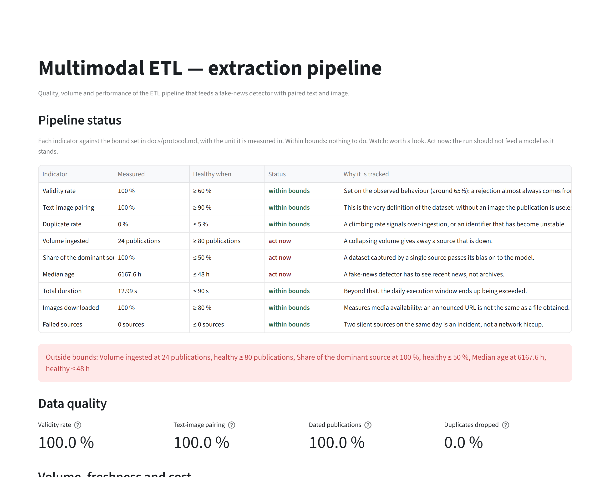
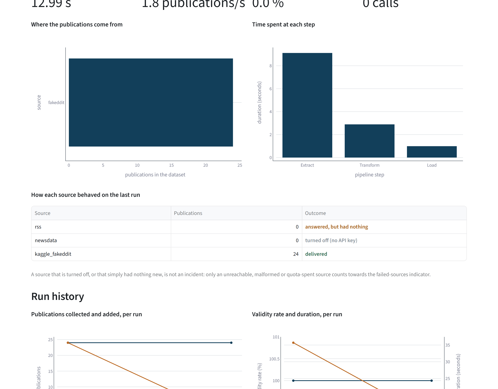
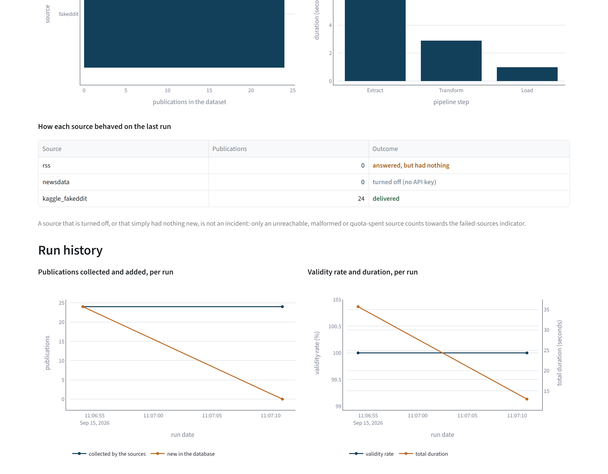

# The dashboard

What the Streamlit page shows, who it is for, and the rules it follows. `docs/protocol.md`
defines the indicators themselves, what each one measures and the bound it is read against.
This document covers the page.

```powershell
uv run streamlit run src/multimodal_etl/dashboard.py
```

The page reads what the pipeline left on disk: the latest dataset under `data/processed/`, the
statistics file written beside it, and one record per run under `data/processed/runs/`. It
computes the indicators from these files each time it loads, and it writes no file. When no
dataset is on disk, the page says so and gives the command that produces one.

## Who reads it

The page is for the person who decides whether the last run's output can feed a model. That
person may not have written the pipeline, so the page assumes no knowledge of the code. Every
reading carries its unit, every bound shows which side of it is healthy, and each row of the
status table states why its indicator is tracked.

## The sections of the page, in order

| Section | The question it answers |
|---|---|
| Pipeline status | Is any indicator outside the bounds `docs/protocol.md` sets |
| Data quality | What survived the cleaning, and how much of it is usable |
| Volume, freshness and cost | How much there is, how old it is, what it took |
| Run performance | How long the run took, and what it added |
| Where the publications come from | Is the dataset concentrated on one source |
| How each source behaved | Which sources delivered, and why the others did not |
| Run history | Is anything drifting, over the runs so far |
| What the pipeline produces | The rows and the image files themselves |

## Three rules the page follows

**A status is written as a word, and its colour repeats it.** Each row of the status table
carries `within bounds`, `watch` or `act now`, written in the colour of that status. A reader who
cannot tell the three colours apart can still read the table.

<!-- source: docs/images/MANIFEST.json -->


**A number carries its unit.** A bound printed as `≤ 48` left the reader to guess between hours,
days and publications. The unit is now a field of each threshold, in
`multimodal_etl.kpi.Threshold`, and the status table and the alert banner both print the reading
and the bound from it. The cards above the charts write their units in `dashboard.py`.

**A source that delivered nothing shows the reason.** The outcome column tells apart a source
that delivered, one turned off for want of an API key, one that returned nothing, and three kinds
of incident: a spent quota, an unreachable source and an unexpected answer. Only the incidents
count towards the failed-sources indicator. A source whose requests all failed, or whose quota
is used up, appears in this column as an incident. The screenshot below predates that
behaviour. It was taken while the connectors still caught their own request errors, so it
reports the unreachable RSS connector as a source that returned nothing.

<!-- source: docs/images/MANIFEST.json -->


## Separate axes for the validity rate and the duration

The run history draws the validity rate as a percentage and the total duration in seconds. On a
shared axis, the quantity with the smaller values is pressed against the baseline, and once runs
take more than a hundred seconds that quantity is the validity rate. Each quantity therefore has
its own axis, labelled with what it carries.

<!-- source: docs/images/MANIFEST.json -->


## Where the colours come from

`.streamlit/config.toml` sets the colours of the page, and `tests/unit/test_theme.py` checks
them against `multimodal_etl.figure_style`, the palette module the charts read. The same file
hides the editor toolbar, with its `Deploy` button and three-dot menu, which used to appear in
every screenshot. Without it, Streamlit would draw its own default red on the buttons, next to
charts drawn in blue and amber.

`st.plotly_chart` applies the Streamlit theme to the charts by default, and each chart also sets
its background, font colour and grid explicitly from the same palette module. `dashboard.py` takes
every colour it uses from that module.

## What the published screenshots show

The three screenshots of the page come from a corpus built for them. `scripts/capture.py` first
runs the pipeline twice on the versioned Fakeddit sample, with NewsData.io given no key and the
feed reader pointed at a port where nothing listens. It then starts the dashboard against that
corpus and photographs three sections. `docs/images/MANIFEST.json` records, for each image, the
state it was taken in and the command that takes it again.

The demonstration sample holds twenty-four rows from a single source, all dated
1 January 2026. In the status capture, the volume ingested, the share of the dominant source
and the median age are therefore outside their bounds, and the capture shows the page naming
the three.
